  

  
  
  

## About

I'm a **first-year B.Tech Computer Science and Engineering (AI/ML) student at SRM University-AP**.

I build end-to-end software, with a primary focus on **applied AI/ML and full-stack engineering**. I also explore quantum computing through simulation-based projects. I enjoy turning ideas into working systems and care about reproducibility, useful tests, clear documentation, and being precise about what a project has—and has not—verified.

**Current interests:** applied AI/ML systems · full-stack applications · reliable software · quantum simulation

## Featured projects

These are the projects that best represent the areas I am exploring. Each repository includes its own setup instructions, implementation details, and limitations.

<table>
  <tr>
    <td width="50%" valign="top">
      <h3>⚡ MerchantShield AI</h3>
      
A sandbox-first prototype for merchant dispute prevention and evidence management.

      
Python · FastAPI · React · TypeScript · PayPal Sandbox · Gemini

      <ul>
        <li>Evidence workflows, explainable rule-based risk scoring, and a separately labelled ML estimate.</li>
        <li>Human-approved action proposals, source provenance, and an append-only audit trail.</li>
        <li>README documents 215 backend tests, 32 browser runs, and 16/16 mutation checks from its recorded local verification.</li>
      </ul>
      
<strong>Scope:</strong> mock and Sandbox paths only; not a live payment-processing product.

      
<a href="https://github.com/ShoryaPratapSinghChandrawat/MerchantShield-AI">Repository ↗</a>

    </td>
    <td width="50%" valign="top">
      <h3>🚪 Doorway Relay</h3>
      
A full-stack event and accountable-handoff application for shared spaces.

      
React · TypeScript · Node.js · Express · SQLite

      <ul>
        <li>REST APIs, persistence, migrations, authentication, CSRF protection, and rate limiting.</li>
        <li>Event-to-handoff workflow, local event simulator, and automated tests.</li>
        <li>Physical Ring-device integration is not represented as verified.</li>
      </ul>
      
<a href="https://shoryapratapsinghchandrawat.github.io/doorway-relay/">Live preview ↗</a> · <a href="https://github.com/ShoryaPratapSinghChandrawat/doorway-relay">Repository ↗</a>

    </td>
  </tr>
  <tr>
    <td width="50%" valign="top">
      <h3>🎧 AudioGuard</h3>
      
A research workspace for spoofed-speech detection using the ASVspoof 2019 Logical Access dataset.

      
Python · MFCC · SVM · Log-Mel CNN

      <ul>
        <li>Feature extraction, model evaluation, and documented research reports.</li>
        <li>Error analysis and robustness experiments with explicit dataset and subset boundaries.</li>
        <li>Results are specific to the documented evaluation setup, not universal deepfake-detection claims.</li>
      </ul>
      
<a href="https://github.com/ShoryaPratapSinghChandrawat/audioguard-deepfake-audio-detection">Repository ↗</a>

    </td>
    <td width="50%" valign="top">
      <h3>🧬 QFF 2026 — Quantum VQE</h3>
      
A team simulation project studying a transverse-field Ising chain.

      
Python · Qiskit · Numerical optimisation

      <ul>
        <li>VQE experiments checked against exact calculations.</li>
        <li>Processor topology, gate counts, and synthetic noise analysis.</li>
        <li>Simulation-based work; no quantum-hardware execution or quantum-advantage claim.</li>
      </ul>
      
<a href="https://github.com/ShoryaPratapSinghChandrawat/qff2026-phase1-s1-ising_chain">Repository ↗</a>

    </td>
  </tr>
  <tr>
    <td width="50%" valign="top">
      <h3>🔎 FlipTrace</h3>
      
A browser-based tool for analysing decision histories and detecting repeated reversals.

      
JavaScript · Web Workers · IndexedDB · Browser APIs

      <ul>
        <li>Imports supported chat, email, and task-history formats.</li>
        <li>Uses rule-based extraction and text-similarity grouping to identify patterns.</li>
        <li>Includes timelines, topic exploration, scoring, and exports.</li>
      </ul>
      
<a href="https://github.com/ShoryaPratapSinghChandrawat/FlipTrace-Decision-Reversal-Detection-Analytics-Platform">Repository ↗</a>

    </td>
    <td width="50%" valign="top">
      <h3>🎮 Neon Bastion</h3>
      
A browser tower-defense game built as a creative coding project.

      
HTML · CSS · JavaScript · Canvas · Web Audio

      
Explores game loops, multiple maps, upgradeable towers, varied enemies, and browser audio.

      
<a href="https://github.com/ShoryaPratapSinghChandrawat/Projects/tree/main/neon-bastion-tower-defense">Project folder ↗</a>

    </td>
  </tr>
</table>

[Explore the complete project collection →](https://github.com/ShoryaPratapSinghChandrawat/Projects)

## Technical focus

  

I use **Qiskit** in my quantum-computing experiments. I keep the technologies shown here tied to tools represented in my public projects rather than listing every technology I have briefly tried.

## Research and hackathons

- **IBM Quantum Qiskit Fall Fest 2026 — Project Q:** shortlisted in Phase 1 and competed in Phase 2. Our team explored VQE-based simulation of a transverse-field Ising chain, exact-reference checks, and processor/noise analysis. [Project repository ↗](https://github.com/ShoryaPratapSinghChandrawat/qff2026-phase1-s1-ising_chain)

## Collaboration

I'm interested in thoughtful collaboration around applied AI/ML, full-stack tools, and reproducible technical experiments. Feedback and well-scoped discussions are welcome through GitHub or LinkedIn.

## Connect

  
  

<i>Curiosity is the interface. Building is the process. Learning is the loop.</i>

