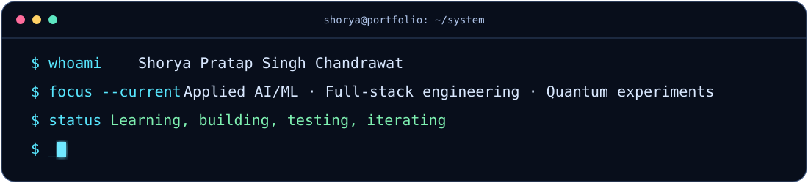
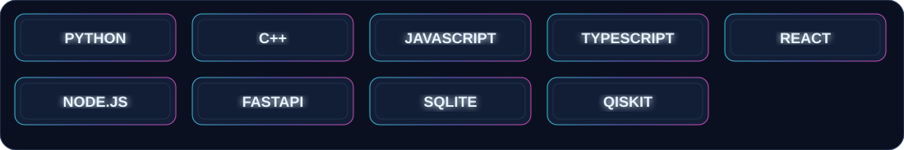

<!--
  PROFILE VISUAL SYSTEM
  Palette: midnight navy / electric cyan / violet
  Note: SVG artwork is stored in this repository's assets/ folder.
-->

  

  
  
  

  

## 

### 
ABOUT THE BUILDER

  B.Tech Computer Engineering (AI/ML) student at <b>SRM University–AP</b> 
  Software developer • AI/ML explorer • curious systems builder

  I enjoy turning ideas into working software — from full-stack applications and data-driven browser tools to machine-learning experiments and quantum-computing simulations. Some projects come from coursework, some from hackathons, and some simply because I wanted to explore an idea.

  
  
  

## 

### 
TECHNOLOGY ARSENAL

  

  

## 

### 
SELECTED BUILDS & EXPERIMENTS

<table>
  <tr>
    <td width="50%" valign="top">
      <h3>⚡ MerchantShield AI</h3>
      
Sandbox-first merchant dispute prevention and evidence-management prototype.

      
Python · FastAPI · React · TypeScript · PayPal Sandbox · Gemini

      
Evidence checklists, risk explanations, human-approved action proposals, provenance labels and audit trails. Demo/simulated paths are identified; it is not a live payment-processing product.

      
<a href="https://github.com/ShoryaPratapSinghChandrawat/MerchantShield-AI">Explore repository ↗</a>

    </td>
    <td width="50%" valign="top">
      <h3>🚪 Doorway Relay</h3>
      
Full-stack event and handoff management application for shared spaces.

      
React · TypeScript · Node.js · Express · SQLite

      
REST APIs, persistence, migrations, authentication, CSRF protections, rate limiting, tests and a local event simulator. Live Ring-device behavior remains unverified.

      
<a href="https://github.com/ShoryaPratapSinghChandrawat/doorway-relay">Explore repository ↗</a>

    </td>
  </tr>
  <tr>
    <td width="50%" valign="top">
      <h3>🎧 AudioGuard</h3>
      
Research workspace for spoofed-speech detection on ASVspoof 2019 LA.

      
Python · MFCC · SVM · Log-Mel CNN

      
Feature extraction, model evaluation, robustness checks and failure analysis. Reported metrics apply only to the documented dataset and evaluation setup.

      
<a href="https://github.com/ShoryaPratapSinghChandrawat/audioguard-deepfake-audio-detection">Explore repository ↗</a>

    </td>
    <td width="50%" valign="top">
      <h3>🧬 QFF 2026 — Quantum VQE</h3>
      
Team simulation project exploring a transverse-field Ising chain.

      
Python · Qiskit · Jupyter · Numerical optimisation

      
Hamiltonian construction, VQE experiments, noise simulation and reproducibility checks. Simulation-based; no hardware execution or quantum-advantage claim.

      
<a href="https://github.com/ShoryaPratapSinghChandrawat/qff2026-phase1-s1-ising_chain">Explore repository ↗</a>

    </td>
  </tr>
  <tr>
    <td width="50%" valign="top">
      <h3>🔎 FlipTrace</h3>
      
Browser-based decision-reversal analytics tool.

      
JavaScript · Web Workers · IndexedDB · Browser APIs

      
Decision-history import, phrase extraction, similarity grouping, reversal detection and timeline views. Uses rule-based and text-similarity methods, not deep learning or an LLM.

      
<a href="https://github.com/ShoryaPratapSinghChandrawat/FlipTrace-Decision-Reversal-Detection-Analytics-Platform">Explore repository ↗</a>

    </td>
    <td width="50%" valign="top">
      <h3>🎮 Neon Bastion</h3>
      
Browser tower-defense game built as a creative coding project.

      
HTML · CSS · JavaScript · Canvas · Web Audio

      
Game loops, multiple maps, tower upgrades, varied enemies and boss encounters.

      
<a href="https://github.com/ShoryaPratapSinghChandrawat/Projects/tree/main/neon-bastion-tower-defense">Explore project ↗</a>

    </td>
  </tr>
</table>

  <a href="https://github.com/ShoryaPratapSinghChandrawat/Projects"><b>More college work, hackathon builds, experiments & free-time projects →</b></a>

## 

### 
ACTIVITY SIGNALS

  

  

  

  

## 

### 
HACKATHONS & RESEARCH

- **IBM Qiskit Fall Fest 2026:** Team project on VQE-based simulation of a transverse-field Ising model; listed as a Phase 2 finalist.
- **Amazon Hackathon:** Top 100, as listed on my LinkedIn profile.

## 

### 
CONNECT WITH ME

  
  

  <i>Curiosity is the interface. Building is the process. Learning is the loop.</i>

  Designed in midnight navy · electric cyan · ultraviolet

